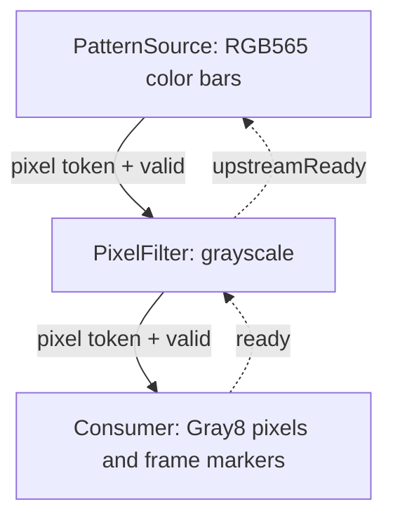

# Eccelerators Video

`Eccelerators.Video` provides reusable streaming-video components for FPGA
applications written in Livt. It combines pixel-stream handshakes, test patterns,
point filters, neighborhood processing and parallel camera capture with explicit
register stages and block-RAM line storage.

Version **1.0.0** depends on **Livt.IO 1.3.0**.
Applications provide sensor configuration, clock-domain crossing and the display,
frame-buffer or network connection.

## ✨ Features

- Coherent ready/valid pixel streams with frame markers and identity
- Gray8 ramp/checker patterns and RGB565 color bars
- Configurable raster dimensions and line blanking
- Combinational pixel forwarding with explicit backpressure
- Elastic grayscale, inversion, saturating brightness and threshold filters
- Filter settings applied at accepted frame boundaries
- Cropped 3×3 windows backed by two explicit block-RAM line stores
- Rounded blur and saturated L1 Sobel arithmetic
- High-byte-first RGB565 DVP capture with malformed-frame and overflow recovery
- Livt regression tests and standalone synthesis probes

Raster dimensions and storage capacities are compile-time configuration.
Point-filter settings can change at runtime, with each frame using the settings
sampled at its accepted start.

## 📦 Installation

Add the package to your project's `livt.toml`:

```toml
[dependencies]
"Eccelerators.Video" = "1.0.0"
```

Run `livt sync`, then import the public API:

```livt
using Eccelerators.Video
```

## 📚 Components

| Component | Purpose |
|---|---|
| `IPixelStream` | Single-clock ready/valid token carrying a 16-bit pixel and coherent frame markers/identity. |
| `PatternSource` | Gray8 ramp/checker and RGB565 color bars, with configurable raster dimensions and line blanking. |
| `PixelBypass` | Combinational token forwarding and returned upstream readiness. |
| `PixelFilter` | One elastic register stage: RGB565 bypass, grayscale, invert, saturating brightness or threshold. |
| `Window3x3` | Cropped Gray8 neighborhoods using two explicit synchronous block-RAM line stores. |
| `PixelMath`, `NeighborhoodMath` | Combinational luminance, brightness, rounded blur and saturated L1 Sobel arithmetic. |
| `DvpRgb565Capture` | High-byte-first parallel RGB565 capture, frame counters and malformed/overflow recovery. |

`VideoProbe` and `WindowProbe` are synthesis examples. Their exported designs have
no board pin assignments or external timing constraints.

## 🔌 Application integration

An application owns the pipeline stages, connects each complete pixel token to
the next stage, and returns readiness from the consumer to the producer. A token
transfers when `valid` and `ready` are true on the same rising clock edge.

The [complete grayscale example](examples/grayscale/src/GrayscaleVideo.lvt)
connects an RGB565 pattern source to a grayscale filter, forwarding all metadata
and backpressure. Its local manifest lets you validate the example directly from this checkout.



Keep pixel data, frame identity and all markers together. Point-filter settings
latch on an accepted frame start; output tokens remain stable while stalled.
The [getting-started guide](docs/GETTING_STARTED.md) explains pattern selection,
filter modes, neighborhood processing and camera integration.

## 🧩 Public API

All production components use the `Eccelerators.Video` namespace.

| API | Consumer contract |
|---|---|
| `IPixelStream` | Producer owns `data`, `valid`, `frameStart`, `lineEnd`, `frameEnd` and `frameId`; consumer owns `ready`. |
| `PixelFilter` | Connect the explicit input token ports and return `upstreamReady`; configure `requestedMode`, `requestedThreshold` and `requestedBrightness`. |
| `Window3x3` | Connect Gray8 input tokens and consume the nine named window pixels with their common handshake and cropped-raster metadata. |
| `PixelMath.Gray`, `PixelMath.Brightness` | Combinational RGB565 luminance and saturating Gray8 brightness calculations. |
| `NeighborhoodMath.Blur`, `NeighborhoodMath.Sobel` | Combinational row-major neighborhood arithmetic; Sobel omits the center pixel. |
| `DvpRgb565Capture` | Supply camera bytes, HREF and VSYNC in the PCLK context; consume pixels and observe capture, malformed-frame and overflow counters. |

See [component contracts](docs/COMPONENT_CONTRACTS.md) for parameter ranges,
latency, reset behavior, storage ownership and failure handling.

## 📐 Limits and integration responsibilities

- `IPixelStream` carries a 16-bit pixel. Gray8 occupies the low byte; RGB565 uses
  the full word. Format is agreed outside the interface and stays fixed per frame.
- `Window3x3` crops one pixel at each border and accepts at most one input pixel
  every two context edges. Buffering and source rates must account for that limit.
- A physical camera cannot pause under backpressure. Capture can reject a frame
  after earlier pixels have already been emitted; consumers require a complete
  raster and final frame marker before treating it as a valid image.
- Clock-domain crossing, sensor configuration, physical camera timing,
  packetization and display/network output belong to the consuming design.

## 🧪 Build and test

From the package directory:

```sh
livt sync
livt validate --offline -R
livt test -R
```

Validate the complete grayscale example:

```sh
livt sync --project examples/grayscale
livt validate --project examples/grayscale --offline -R
```

Export the source and window synthesis probes:

```sh
livt vendor gowin-ip --project . -R
livt vendor gowin-ip --project verification/window -R
```

The eight Livt test components check pixel arithmetic, raster markers, stalls,
sustained source throughput, frame-boundary filter settings, line-buffer windows
and DVP rejection/recovery. Synthesis probes let consumers inspect logic and RAM
mapping; resource counts and Fmax depend on the target and build.

## 📖 Documentation

- [Getting started](docs/GETTING_STARTED.md): wiring, formats, filter settings and examples.
- [Stream contract](docs/STREAM_CONTRACT.md): acceptance, stalls, reset and clock crossings.
- [Component contracts](docs/COMPONENT_CONTRACTS.md): ownership, dimensions, latency, storage and errors.
- [Changelog](CHANGELOG.md): 1.0.0 release contents.
